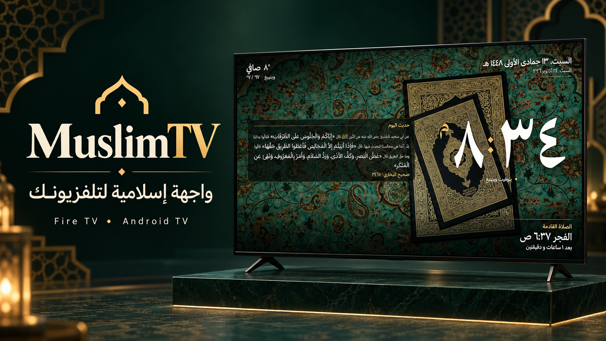
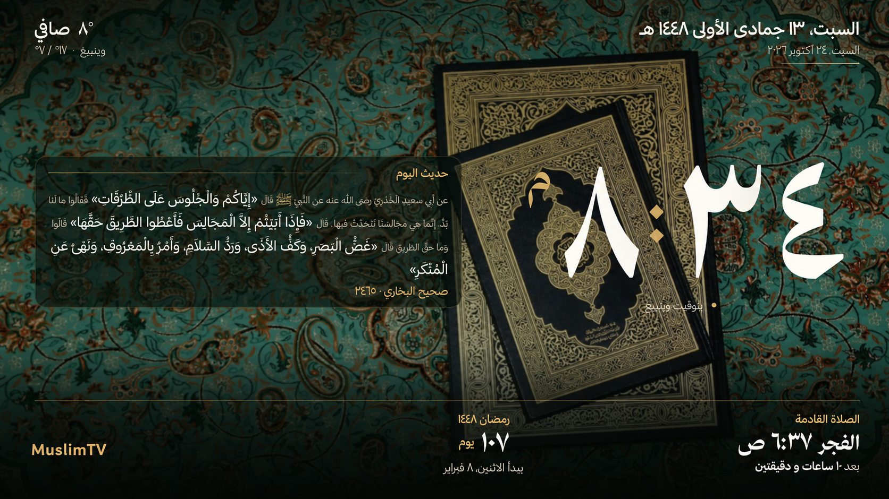

## انسخ النص التالي والصقه في الذكاء الاصطناعي

```text
ثبّت وأعدّ MuslimTV على جهاز التلفزيون الخاص بي من هذا المستودع:
https://github.com/MoSbeaa/MuslimTV.git
انسخ فرع main، واقرأ docs/SETUP-PROMPT.md واتبع التعليمات بالترتيب.
ابدأ بفحص بيئة الحاسوب والجهاز، واسألني فقط عن المعلومات الناقصة.
إذا كانت هناك نسخة مثبتة، فاحفظ إعداداتي وتطبيقاتي وخلفياتي قبل أي تغيير.
تواصل معي بالعربية الفصحى، وأخبرني عند الانتهاء بكيفية تشغيل الواجهة والعودة إلى إعدادات الجهاز.
```

استخدم مساعدًا يستطيع تنفيذ الأوامر محليًا على حاسوب متصل بالشبكة نفسها التي يتصل بها التلفزيون. يصلح النص لأي مساعد بهذه الإمكانات؛ أما المحادثة التي لا تستطيع الوصول إلى الحاسوب، فيمكنها إرشادك لتنفيذ الخطوات يدويًا.

---

# MuslimTV



<div dir="rtl">

## واجهة إسلامية لتلفزيونك

**MuslimTV** واجهة رئيسية وشاشة توقف لتلفزيونات **Android TV** وأجهزة **Fire TV**، بألوان خضراء وذهبية قابلة للتخصيص، وساعة بالأرقام العربية، وخط **Rakkas** للنصوص العربية.

### المزايا

- تثبيت TizenTube Cobalt تلقائيًا للمستخدمين الجدد إن لم يكن موجودًا، ووضعه أول تطبيق افتراضيًا.
- [مصحف MuslimTV للتلفاز](docs/QURAN-TV.md) بعد TizenTube: صفحتان، فهرس بالريموت، تكبير، وحفظ موضع القراءة، دون خدمات Google.
- بطاقات مفضلة برموز مبسطة تتبع ألوان الثيم تلقائيًا، مع خيار الرجوع إلى صور التطبيقات الأصلية.
- ترتيب التطبيقات المفضلة والتنقل باستخدام جهاز التحكم، مع الحفاظ على الترتيب المحفوظ عند التحديث.
- خمسة اختصارات فيديو قابلة لتعديل العناوين والروابط، مع فتحها في TizenTube.
- مواقيت الصلاة من **MiaOnline** مع عرض الصلاة القادمة.
- تشغيل الأذان داخل الواجهة وشاشة التوقف، مع خيار مستقل لتشغيله أثناء استخدام التطبيقات الأخرى.
- تنبيه صلاة أعلى يمين الشاشة أثناء استخدام التطبيقات؛ صامت افتراضيًا مع إمكانية تفعيل صوت الأذان.
- ساعة صغيرة فوق التطبيقات الأخرى بتوقيت وينبيغ، قابلة للإخفاء من الإعدادات.
- اختيار أصوات الأذان والاستماع إليها قبل الحفظ: مكة، القدس، المدينة، والعفاسي، إضافة إلى تسجيلين من سوريا وناصر القطامي والأذان الدمشقي الجماعي وعمر هشام العربي، مع خيارات للفجر.
- حديث يتغيّر يوميًا، وطقس أسبوعي، وعدّاد رمضان.
- ألوان جاهزة وألوان مخصصة، وخلفيات متناوبة متاحة دون اتصال.
- عدّاد اختياري لموعد مخصص؛ عنوانه وتاريخه محفوظان محليًا، وهو مخفي افتراضيًا.
- الوصول إلى إعدادات Fire TV وواجهة أمازون، ثم العودة إلى MuslimTV.

### شاشة التوقف



صور العرض توضيحية، أُعدّت بالاستناد إلى المظهر الحالي للتطبيق مع حذف المعلومات الشخصية. أوقات الصلاة والطقس الظاهرة فيها أمثلة وليست جدولًا حاليًا.

### مكوّنات المشروع

| المجلد | الوظيفة |
|---|---|
| `android/launcher` | الواجهة الرئيسية وترتيب التطبيقات والاختصارات والألوان |
| `android/app` | شاشة التوقف والإعدادات ومواقيت الصلاة والأذان |
| `firetv-bridge` | تحويل زر Home والتنبيهات على Fire TV |
| `src` | قالب الشاشة وأداة إنشاء الصفحات |
| `dist` | الصفحات المُنشأة، بما فيها `muslimtv.html` للاستخدام المستقل |
| `photos` | صور الخلفيات الأصلية والنسخ المحسّنة للتلفزيون |
| `docs` | تعليمات الإعداد والتخصيص |

### الإعداد

1. فعّل خيارات المطوّر وتصحيح ADB على الجهاز، واجعل الحاسوب والجهاز متصلين بالشبكة نفسها.
2. انسخ هذا المستودع: `https://github.com/MoSbeaa/MuslimTV.git`.
3. اتبع [دليل الإعداد](docs/SETUP-PROMPT.md) بحسب نوع جهازك. يتطلب Fire TV مساعد التحويل الموجود في `firetv-bridge`؛ ولا يستبدل التطبيق نظام التشغيل.

يمكن تثبيت التطبيقات المبنية محليًا أو استخدام [الإصدارات المنشورة](https://github.com/MoSbeaa/MuslimTV/releases) عند توفرها. يتطلب النشر التلقائي إعداد أسرار التوقيع أولًا.

### البناء

```sh
python src/build.py
gradle -p android :app:assembleRelease :launcher:assembleRelease
```

لبناء مساعد Fire TV على Windows، اضبط `JAVA_HOME` وثبّت Android SDK، ثم شغّل:

```powershell
./firetv-bridge/build.ps1 -NoInstall
```

معرّفات التثبيت: `sa.muslimtv.home` و`sa.muslimtv.screensaver` و`io.github.toolicious.homeonfire.muslimtv`. الانتقال من إصدار ذي معرّفات مختلفة يتطلب نقل الإعدادات قبل حذف التطبيقات السابقة.

### الخصوصية

صور الخلفيات منشورة بموافقة مالكها. لا يتضمن الإصدار الحالي موعدًا شخصيًا مُبرمجًا داخل الكود. ملفات التوقيع ونسخ إعدادات الجهاز وسجلات التشغيل مستبعدة من Git.

### أدلة التخصيص

[الأذان](docs/ADHAN.md) · [الألوان](docs/THEME-COLORS.md) · [الاختصارات](docs/QUICK-LINKS.md) · [الطقس والحديث](docs/DAILY-HADITH-WEEKLY-WEATHER.md) · [الخلفيات](docs/PHOTO-UPDATE.md) · [Fire TV وأمازون](docs/AMAZON-ACCESS.md)

</div>

## English

MuslimTV is an Islamic home screen and screensaver for Fire TV and Android TV. It includes Arabic typography, configurable themes, local wallpapers, daily hadith, weekly weather, MiaOnline prayer times, selectable adhan recordings with previews, and silent prayer banners over other apps. The public custom-event countdown is disabled by default and stores its title/date locally.

The promotional images reflect the current visual style and omit personal event information; they are illustrative rather than live schedule screenshots. Existing TV backgrounds are unchanged.

## Credits

Based on the original work of [tshi-dev](https://github.com/tshi-dev), with a Fire TV bridge derived from [Home on Fire](https://github.com/toolicious/home-on-fire). Original copyright notices, the launcher license, bridge GPL license, font licenses, photo credits and audio-source metadata are retained in their respective directories.
